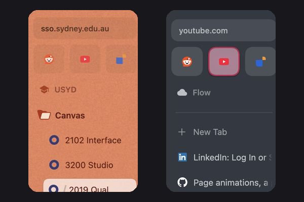

# Arc Sidebar

Makes Zen's sidebar look like Arc's. Every value was measured from side-by-side screenshots of Arc and Zen, so it matches row heights, text, colours and highlights to within about a pixel.

## What it changes

| Option | What you get |
|---|---|
| **Arc row height, text size and indents** | 41px rows (Zen uses 40px), 14px tab titles, semibold folder and space names, folders indented like Arc, a wider gap after "+ New Tab", and slightly taller Essentials tiles |
| **Tint text, folders and space icon with the space colour** | On light spaces, text becomes a dark shade of the space colour, and folder and space icons take a deeper accent, as in Arc. Dark spaces keep Zen's light text. |
| **Arc-style hover and selected tab** | Hover darkens a row slightly. The selected tab is a soft white card with a hairline edge and a faint shadow. |
| **Arc-style Essentials highlight** | The selected Essential gets a thin ring in the site icon's colours around a light panel, not a solid white fill. Unselected tiles are lifted the way Arc's are. |
| **Smaller URL text like Arc** | The URL pill's text is about 7% smaller and inset a little more. |

Every option is on by default. Turn any of them off under **Settings → Zen Mods → Arc Sidebar**.

Corners use Zen's own 14px radius and squircle shape, which matches Arc's selected-tab corner, so the mod leaves corners alone.

## Matching your Arc space colours

A mod can't set space colours, because Zen stores those for each space. To match a space to Arc:

1. Right-click the space and choose **Edit Theme**.
2. Pick the space's Arc colour, one dot only.
3. Set opacity to match Arc's look. Light Arc colours need close to full opacity, because Zen lets the window behind show through and that mutes them.

## Notes

- Built for Zen 1.23 on macOS. Tested on light and dark spaces.
- The Essentials ring needs Zen's **Essentials favicon background** setting, which is on by default.
